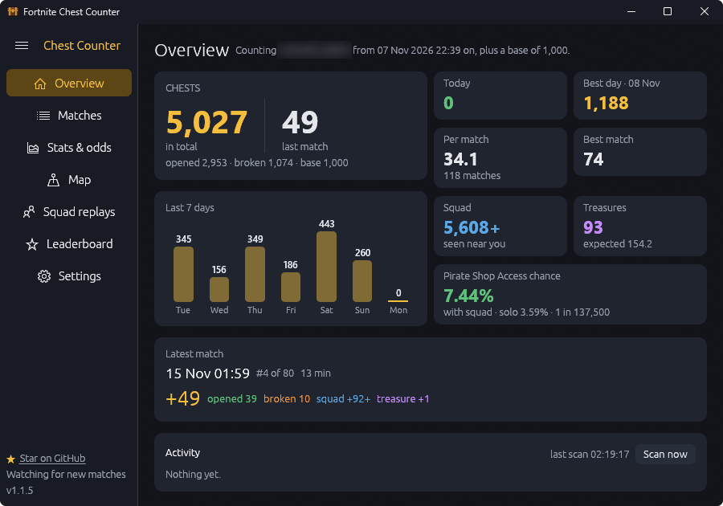

# Fortnite Chest Counter

Counts every chest you open and break in Fortnite, from the replays the game already
saves. The Treasure Hunters quest stops counting at 1,000. This app keeps going and also
counts your squad's chests and your chance of Pirate Shop Access.

**[Download](../../releases/latest)** · Windows 10 and 11 · free and open source

## Get started

1. Download `fortnite-chest-counter.exe` from the [latest release](../../releases/latest).
   One file, no installer.
2. In Fortnite turn on **Settings > Game > Replays > Record Replays**.
3. Run the exe. It isn't code-signed, so Windows may say "Windows protected your PC":
   click **More info > Run anyway**.

A three-step setup picks your language and where to start counting. Then play: the app
waits in the tray and counts each match when you're back in the lobby. It updates itself
while Fortnite is closed.

## What it does

- **Every chest, every match**: opened, broken with a pickaxe or rammed with a vehicle,
  on a timeline and a map.
- **Squad chests and prize odds.** A prize goes to the whole squad. Squadmates who run the
  app with Online mode swap their exact counts with you; for the rest, add their replays.
- **Overlay in the game, in OBS and in your Discord status.**
- **Leaderboard** of everyone who shares their counts.
- **Several Epic accounts** on one PC, each with its own total.
- **18 languages**, the same as in Fortnite.

## Privacy

The app reads replay files and Fortnite's log on your PC. It doesn't touch the game, its
memory or its network traffic, and never signs in to your Epic account.

Online mode (on by default, Settings > Online) sends your Epic account id and name and
your chest counts per match to `chests.l4ve.dev`; squadmates get them only for matches
you played together. The Discord status, also on by default, shows your chests on your
Discord profile while you play (Settings > OBS and Discord). Turn both off and nothing
about you leaves your PC. Every detail is in the [guide](docs/guide.md#privacy).

## More

- [Guide](docs/guide.md): every page and setting, squad chests, finding when your
  quest finished, known limitations.
- [How it counts](docs/development.md) and how to build it yourself.
- [What's new](changelogs/en.md) in each version.

Unofficial fan tool, not affiliated with or endorsed by Epic Games. Fortnite is a
trademark of Epic Games, Inc. Licensed under [Apache 2.0](LICENSE).
