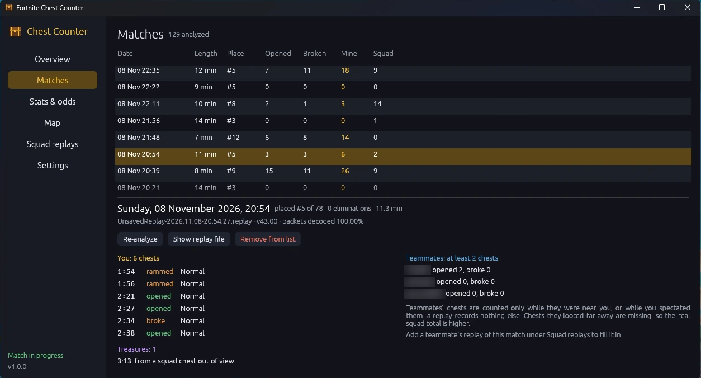

# Fortnite Chest Counter

Counts the chests you open and break in Fortnite by reading your replay files.



During Treasure Hunters every chest you open or destroy rolls for rewards like the Pirate
Shop Access token, and a reward goes to your whole squad. The in-game quest stops counting
at 1,000. This keeps going, per match.

> Unofficial fan tool, not affiliated with or endorsed by Epic Games. It only reads the
> replay files Fortnite saves on your PC. It doesn't touch the game process, its memory or
> its network traffic.

## Features

**Online mode.** Your replay only sees a teammate's chests when they loot near you. If
they run the app too, you get their real count instead. There's no friend list and no
code to share: after each match the app sends your own numbers, and anyone who was in
your squad that match gets them. You get theirs the same way. Their full count goes into
your squad total and your prize odds, and the match shows a chest icon next to their
name. It's on by default; Settings > Online turns it off. See [Privacy](#privacy) for
what gets sent.

- **Counts every chest you open or break**, match by match, from the replays Fortnite
  already saves. Nothing to type, it reads who you are from the replay.
- **Keeps counting past the quest's 1,000.** Start from where your quest is and every
  match adds on top.
- **Squad chests and Pirate Shop odds.** A prize goes to the whole squad, so the app
  counts squad chests, your chance of at least one Pirate Shop Access token and the
  treasures you've received.
- **A timeline for every match**: each chest opened, broken with a pickaxe or rammed with
  a vehicle, timed from the battle bus launch.
- **A map** of where you looted, on the island with its location names.
- **A running total chart**, with a line for every squadmate who runs the app.
- **An in-game overlay** with your count. Click the lock in its corner to move and
  resize it; locked, clicks go straight through to the game.
- **Runs in the tray** and counts each match when you're back in the lobby, with a
  notification.
- **Keeps copies of your replays**, because Fortnite deletes everything past the last 100.
- **Updates itself** from this repository's releases.

## Install

1. Download `fortnite-chest-counter.exe` from the [latest release](../../releases/latest).
   It's a single file with no installer and no dependencies.
2. In Fortnite, turn on **Settings > Game > Replays > Record Battle Royale Replays**.
3. Run the exe. It isn't code-signed, so SmartScreen may show "Windows protected your PC".
   Click **More info > Run anyway**, or [build it yourself](#build-from-source).

Windows 10 or 11, 64-bit.

**Updates.** The app looks for a new release here every 10 minutes (or when you press
Settings > Updates > Check for updates). When there is one, an **Update to vX** button
shows up in the sidebar: it downloads the new exe, checks it against the release's
SHA-256 file and restarts into it. Your matches and settings stay as they are.

Each release has three files:

- `fortnite-chest-counter.exe`: the app. This is all you need.
- `fortnite-chest-counter.exe.sha256`: its checksum, used by the in-app updater.
- `fortnite-chest-counter-<version>-windows-x64.zip`: the same exe with the README, the
  license files (including those of every library built into it) and the Epic profile
  script. You don't need it to run the app; it writes the script out when you ask.

## Using it

**First run.** A short setup asks where to start counting:

- **Still working on the quest?** Enter its current progress and the current time.
- **Already finished it?** Enter the quest's total (say, 1000) and when it finished. If you
  don't know when, the app can find out; see [When did my quest finish?](#when-did-my-quest-finish)

There's no name to type: every replay records who played it.

**Then play.** The app runs in the tray and counts each match when you're back in the
lobby. You get a notification per match, and the tray tooltip shows your total. Open the
window from the tray icon for:

- **Overview**: your total, your squad's, your chance of at least one Pirate Shop Access,
  and treasures you've received.
- **Matches**: every match with a timeline of each chest: opened, broken with a pickaxe,
  or rammed with a vehicle. Times count from the moment the battle bus launched.
- **Stats & odds**: chests by type, chests needed for a 25/50/90% chance, expected drops
  for every reward and how lucky you've been so far.
- **Map**: where you opened and broke chests, over the island with its location names.
  Click a marker to see which chest of the match it was and when; the arrows step through
  the rest of that match's chests. Map > Change picture swaps in your own picture of the
  island.
- **Squad replays**: add replays your teammates recorded to fill in what yours missed.
- **Settings**: replay folder, autostart, replay archiving, and an in-game overlay that
  shows your count on top of the game (off by default; mouse clicks pass through it).
  Put it in a corner, or click the lock in its top right corner to drag it anywhere and
  size it, then click the lock again.

Fortnite keeps only your latest 100 replays. Turn on archiving in Settings to keep copies
of counted matches, up to a size you choose. Chests from matches whose replays are already
gone can be added by hand under Settings > Counting > Added by hand (a minus takes some off).

Everything the app stores lives in `%APPDATA%\Fortnite Chest Counter`.

### Teammates' chests

A replay only records what was near you, so teammates who loot far away barely show up in
yours. Squad numbers are therefore marked as a lower bound ("152+").

**Online mode** (on by default, Settings > Online) fixes that for squadmates who run the
app too, even ones you don't know. After each match the app sends your own chest count for
it to the sync server and asks for your squadmates' counts. Anyone in your squad with the
app gets your numbers and you get theirs, from their own replay, so their chests count in
full: in the squad total, the prize odds and the match details, where they get the app's
chest icon next to their name. Stats > Running total draws a line for each of them over
the matches you played together (Settings > Online picks whose). The first sync sends
every match you already have. Turn the mode off and nothing is sent.

For teammates without the app, ask for their replays
(`%LOCALAPPDATA%\FortniteGame\Saved\Demos`) and drop them on the **Squad replays** page.
Each replay is matched to yours by the match id the server gives everyone in a match,
never by date or time, and nothing gets counted twice.

### When did my quest finish?

Fortnite shows that a quest is done but not when. Your Epic profile has the exact time,
and the app can read it from a file you download yourself:

1. In **Settings > Counting**, expand *Not sure when your quest stopped counting?* and click
   **Open the script folder**. Double-click `get-epic-profile.bat`.
2. Your browser opens an Epic Games page. Sign in if asked. The page shows a line of text
   with `authorizationCode` in it. Copy it.
3. Paste it into the script window and press Enter. The script saves `epic-profile.json`
   and closes the Epic session right away.
4. Back in the app, click **Import epic-profile.json** and then **Save**.

The app fills in your starting count and time and shows the match the quest finished in.
That match isn't counted: Epic records quest progress when you leave a match, so the quest
already took its chests.

`epic-profile.json` contains your account's game data (cosmetics, stats, quests), so keep
it to yourself and delete it when you're done. The script signs in the way the game does,
which Epic doesn't officially support for other programs; it only reads your profile. You
can read the whole script before running it:
[get-epic-profile.ps1](crates/app/scripts/get-epic-profile.ps1).

**Fortnite Chest Counter never gets access to your Epic account. It doesn't see your
password, the sign-in code or the session. It only reads the file you give it, on your PC.**

## Privacy

- The app reads replay files from your PC and writes its data to
  `%APPDATA%\Fortnite Chest Counter`.
- It asks GitHub for this repository's latest release every 10 minutes (Settings >
  Updates turns it off). Nothing about you goes with that.
- Online mode (on by default; Settings > Online turns it off) sends `chests.l4ve.dev` your
  Epic account id and name, and for each of your matches its id, start time and the chests
  you opened and broke, plus a random id of this installation. To get a squadmate's
  numbers the app needs the match id and their account id, both from your own replay of
  that match, so your numbers go only to people who played in your squad. Nothing else:
  no replays, no other players' names, no analytics.
- No accounts. (The optional Epic profile script talks to Epic, and only when you run it.)

## Known limitations

- **Buried chests can be missed.** Their fields sometimes reach the replay only after the
  chest has already been dug up, and no other chest class shares their layout to fill
  the gap.
- **Prize types aren't recorded.** The replay shows that a treasure arrived, not which one.
- **The overlay** needs Fortnite in Windowed Fullscreen; exclusive fullscreen draws over it.
- **The map calibration** fits the current island (v43). A new season's island needs a new
  fit in `crates/app/src/ui/map.rs`.
- **Fortnite updates** occasionally change the replay format. If the Overview warns that
  replays didn't decode cleanly, the app needs an update.

## How it counts

Fortnite replays are Unreal Engine network recordings: the game state your client received
during the match, encrypted and compressed. The app decodes that stream and looks at the
chests in it.

- **Opened:** the chest's `bAlreadySearched` flag turns on and `SearchingPawn` names who
  opened it.
- **Broken:** when a chest is destroyed, by pickaxe, gunfire or vehicle, the server sets
  `SearchingPawn` to whoever destroyed it without marking it searched. A chest you already
  opened isn't counted again when you break it.
- **Treasures:** a prize grants the recording player a `GA_TreasureHandler` ability, so the
  replay shows exactly when it arrived and which nearby chest rolled it.
- **Opens the replay lost:** some recordings go minutes without chest updates (often the
  first minutes of a match) while the loot still records. A chest's worth of loot (3 to
  6 items, a weapon among them, thrown out of a container) landing at a player's feet,
  with no recorded open, break or ammo box there, counts as that player's open. The match
  timeline marks these "opened*". Items a player drops, on death or by hand, carry who
  dropped them and are never taken for a chest.

Apart from those opens found from loot, every count is a recorded event. As a sanity check over 46 matches: 97% of
the opens were followed by container loot landing next to the player within 2.5 s, and
94% of the breaks by the chest disappearing within 8 s.

Technical details are under [How it works](#how-it-works) below.

## Build from source

You need:

- **Windows 10 or 11** (64-bit).
- **Rust 1.92 or newer.** Install it from [rustup.rs](https://rustup.rs) and keep the
  default `x86_64-pc-windows-msvc` toolchain.
- **Visual Studio Build Tools** with the **Desktop development with C++** workload. Rust
  uses its linker, and its Windows SDK compiles the app's icon and version info. rustup
  offers to install it if it's missing.
- **Git**, to clone the repository (or download it as a zip from GitHub).

Then:

```sh
git clone https://github.com/andruhan123YT/fortnite-chest-counter.git
cd fortnite-chest-counter
cargo build --release
```

The first build downloads dependencies and takes a few minutes. The app ends up at
`target\release\fortnite-chest-counter.exe` and needs nothing else to run.

To run the tests:

```sh
cargo test --workspace
```

To build the same zip the releases have (exe, README, licenses, profile script; needs
Python 3):

```sh
python tools/package.py
```

It lands in `dist\`, next to `fortnite-chest-counter.exe.sha256`.

To release an update: set the new `version` in the root `Cargo.toml`, commit, then push a
tag with the same version (`git tag v1.0.1 && git push origin v1.0.1`). GitHub Actions
runs the tests, builds the exe, its `.sha256` and the zip and publishes them as a release
(`.github/workflows/release.yml`). Installed apps offer the update within 10 minutes. They
look for exactly those two file names, so keep them.

Not in this repository: build output (`target\`, `dist\`) and replay files (5 to 30 MB
each, and they contain other players' names). The island picture the map shows is
`crates/app/assets/map.png`, built into the exe.

## How it works

The workspace has three crates:

| Crate | Purpose |
|---|---|
| `crates/fnreplay` | Reads the replay container (AES-256, Oodle), then walks the network stream the way Unreal's demo driver does: frames, packets, bunches, actor channels, net GUIDs, replicated property layouts, `ClassNetCache` fields and fast array deltas. Knows nothing about Fortnite. |
| `crates/chests` | The Fortnite schema (pawns, player states, chests, pickups, vehicles, abilities) and the analysis: opens, breaks, treasures, squads, drop odds. |
| `crates/app` | The egui desktop app, tray, overlay, folder watcher, replay archive, command line, online mode and the Epic profile script. |

`fnreplay` decodes only the properties the schema asks for and skips everything else
bit-exactly, since every property payload is length-prefixed.

Fortnite exports a replicated field once for a whole family of chest classes. A child
class such as `AlwaysSpawn_NormalChest_C` can replicate `bAlreadySearched` and
`SearchingPawn` long before (or without ever) exporting them under its own name, so
`fnreplay` resolves a missing handle through any class with the same schema group and the
same number of fields.

**Opens.** A chest update with `bAlreadySearched` set and a `SearchingPawn` is an open.
When a chest re-enters network relevancy, the server resends its whole state, old
`SearchingPawn` included; those updates also carry `Role` and are ignored. A chest created
already searched (a dug-up buried chest) still counts when its searcher stands within 5 m.
Pawns resolve to players through `PlayerState` and the lightly obfuscated
`PlayerNamePrivate`.

**Breaks.** A `SearchingPawn` update without `bAlreadySearched` (and not a full-state
resend) is a break by that player; the chest despawns about 5 s later. Opened chests stay
in the world: of 1,901 opens, only 116 despawned within 8 s, and those were broken
afterwards. An older loot-burst heuristic is still available under Settings > Advanced; it
over-counts on current replays.

**Owner and treasures.** `Athena_GameState.RecorderPlayerState` names the recording player.
A prize arrives as a `GA_TreasureHandler_*` element in the `ActivatableAbilities` fast
array of the player's `AbilitySystemComponent` (a stably named subobject). Only the
recorder's abilities replicate in full, and the handler is generic, so the replay shows
when a prize arrived but not which one. Prizes are squad-wide: over 100 replays the
recorder received 39 against about 14 expected from their own 901 chests. Expected drops
therefore use squad chests.

**Teammates' replays.** `Athena_GameState.GameSessionId` is the same in every player's
replay of a match, unlike the replay's GUID (one per recording) or its timestamp (the
recorder's clock). For each player, whichever linked replay saw the most of their chests
supplies their whole record.

**Online mode.** `FortPlayerStateAthena.UniqueID` is a `FUniqueNetIdRepl`: a flags byte,
a length byte and the 16-byte Epic account id. The app uploads the recorder's own count
per `GameSessionId` and looks up the account ids of the recorder's squad in the same
match. A squadmate's own number replaces what the recorder's replay saw of them, unless
the replay saw more. The server keeps one record per player per match and answers only
for the exact match and account ids asked about.

### Command line

The exe doubles as a command-line tool:

```
fortnite-chest-counter analyze <replays or folders>... [--nick NAME] [--json]
fortnite-chest-counter info <file.replay>
fortnite-chest-counter dump-events <file.replay>
fortnite-chest-counter list-exports <file.replay> [filter]
fortnite-chest-counter update [--check]
fortnite-chest-counter --minimized
```

`analyze` prints per-match counts, treasures, a chest timeline, who recorded the replay
and the match id. `info` shows the replay's versions and how many network packets decoded
cleanly. `list-exports` lists every replicated class and property, for finding renamed
ones after an update. `update` installs the latest release (`--check` only reports it).

### After a Fortnite update

1. Run `fortnite-chest-counter info` on a new replay and note the engine network version
   and the share of packets that decoded.
2. Look for new version-gated fields in Unreal Engine's `DataChannel.cpp` and
   `NetSerialization.h`, and for renamed chest or vehicle classes (`list-exports`).
3. Add them to `fnreplay` behind `versions.engine_network` checks, or to the schema in
   `crates/chests/src/schema.rs`.
4. Bump `ANALYZER_VERSION` in `crates/app/src/record.rs` so stored matches get re-analyzed.

## Status

Tested on 100+ replays from Fortnite v43.00 (engine network version 45): every packet
decodes. Match ids were checked across two players' replays of the same four matches. The
overlay has been checked over the game in Windowed Fullscreen. The updater was tested end
to end against a local copy of a release, including a download with a wrong checksum.

## License

Apache License 2.0; see [LICENSE](LICENSE) and [NOTICE](NOTICE). Release zips include
`THIRD_PARTY_LICENSES.txt` for the open-source crates built into the exe. Fortnite is a
trademark of Epic Games, Inc.; game artwork and data are not part of this project.
